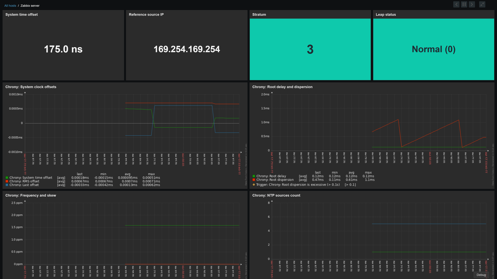
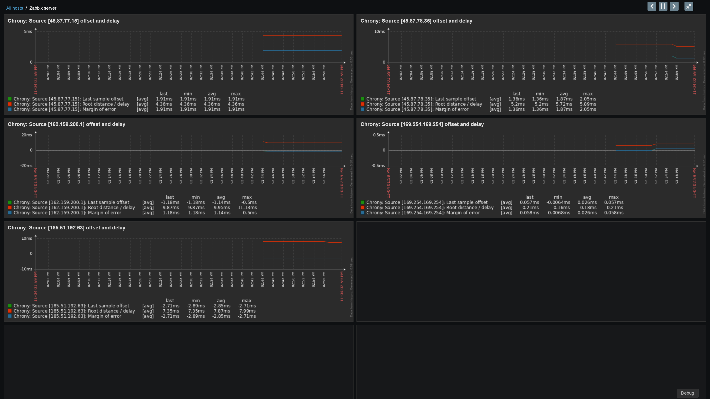

# Zabbix Chrony NTP Monitoring Template (`zabbix-template-chrony`)

[🇬🇧 Read in English](README.md) | [🇷🇺 Читать на русском](README_RU.md)

[](https://www.zabbix.com/)
[](https://chrony-project.org/)
[](https://www.zabbix.com/documentation/current/en/manual/concepts/agent2)
[](https://github.com/qwertykolea/zabbix-template-chrony)

A production-grade, highly efficient Chrony NTP client monitoring suite designed for **Zabbix Agent 2** and compliant with official Zabbix 7.4 standards.

Features the **Master + Dependent Items** pattern, raw CSV output parsing via native Zabbix Preprocessing, automated Low-Level Discovery (LLD) of all upstream NTP sources, native Zabbix 7.0+ template dashboard, Grafana dashboard integration, zero external bash scripts, and minimal system overhead.

---

## 🚀 Key Features

* **Minimal System Overhead**: Only 2 `chronyc` queries per minute (`tracking` and `sources`) polled as single-line CSV data. Zero CPU/disk spikes.
* **Zero External Shell Scripts**: 100% self-contained configuration in a single 2-line `.conf` file inside Zabbix Agent 2 (`/etc/zabbix/zabbix_agent2.d/chrony.conf`).
* **Locale-Independent Native Preprocessing**: Raw CSV data parsed in-memory using Zabbix JavaScript and JSONPath engines. No fragile English-text regex or awk/sed dependencies.
* **Pure NTP Client & Server Support**: Monitors both pure client-only endpoints (workstations, VMs) and full NTP servers without expecting open UDP 323 sockets or connected peers.
* **Dual Architecture Templates**: Fully maintained deterministic templates for both **Passive** (Zabbix Server polling) and **Active** (Agent pushing through NAT/firewalls).
* **Automated Peer Discovery (LLD)**: Dynamically discovers every configured upstream NTP source, tracking individual offset, delay, dispersion margin, reachability, and stratum.
* **Production-Grade Alerting & Triggers**: Multi-level warning and critical thresholds with daemon crash dependencies, leap second detection, and false-ticker isolation.
* **Native Multi-Page Zabbix Dashboard**: Modern dark-mode dashboard with KPI cards, multi-row peer graph grids, and time-range synchronization (`DASHBOARD._timeperiod`).
* **Grafana Dashboard Included**: Ready-to-import JSON dashboard optimized for the official Zabbix plugin.

---

## 📁 Repository Structure

```text
zabbix-template-chrony/
├── README.md                                 # English Documentation
├── README_RU.md                              # Russian Documentation
├── agent2_conf/
│   └── chrony.conf                           # Lightweight UserParameter config for Agent 2
├── templates/
│   ├── template_chrony_agent2_passive.yaml   # Template for Passive Agent (Zabbix Server pulls metrics)
│   ├── template_chrony_agent2_active.yaml    # Template for Active Agent (Agent pushes metrics)
│   └── generate.py                           # Deterministic template & UUID generator
├── dashboards/
│   └── grafana/
│       ├── chrony-overview.json              # Production Grafana Dashboard for Zabbix plugin
│       ├── README.md                         # Grafana setup guide (EN)
│       └── README_RU.md                      # Grafana setup guide (RU)
└── deploy/
    ├── install.sh                            # Automated 1-click Linux host installer
    ├── uninstall.sh                          # Clean uninstaller
    └── ansible/                              # Fleet automation via Ansible
        ├── playbook.yml                      # Ansible playbook
        ├── inventory.ini.example             # Example inventory
        ├── README.md                         # Ansible guide (EN)
        └── README_RU.md                      # Ansible guide (RU)
```

---

## ⚡ Quick Start (Linux Host Setup)

### Option 1: One-Line Online Installation from GitHub (Recommended)

Run directly on your target Linux host:

```bash
curl -fsSL https://raw.githubusercontent.com/qwertykolea/zabbix-template-chrony/main/deploy/install.sh | sudo bash
```

### Option 2: Run Locally from Cloned Repository

```bash
git clone https://github.com/qwertykolea/zabbix-template-chrony.git
cd zabbix-template-chrony/deploy
sudo chmod +x install.sh
sudo ./install.sh
```

### Option 3: Manual Installation (1 minute)

1. Copy the configuration file:
   ```bash
   sudo cp agent2_conf/chrony.conf /etc/zabbix/zabbix_agent2.d/chrony.conf
   sudo chmod 644 /etc/zabbix/zabbix_agent2.d/chrony.conf
   ```

2. Restart Zabbix Agent 2:
   ```bash
   sudo systemctl restart zabbix-agent2
   ```

3. Verify metric collection:
   ```bash
   zabbix_agent2 -t chrony.tracking
   zabbix_agent2 -t chrony.sources
   ```

---

## 🖥️ Zabbix Web UI Configuration

1. Navigate to **Data collection** -> **Templates** -> click **Import**.
2. Select the template file from the `templates/` folder:
   * `template_chrony_agent2_passive.yaml` — for hosts reachable directly by Zabbix Server/Proxy on port 10050.
   * `template_chrony_agent2_active.yaml` — for hosts behind NAT / firewalls where the agent initiates outbound connections to port 10051.
3. Link the imported template to your target hosts under **Data collection** -> **Hosts**.
4. View incoming metrics in **Monitoring** -> **Latest data** (filter by application `Chrony`).

---

## 📊 Monitored Metrics

### 1. System Synchronization Metrics (Tracking)

* **`Chrony: Service process state` (`proc.num[chronyd]`)**  
  * **Description**: Verifies that the `chronyd` background daemon process is alive and running.
  * **Values**: `1` = Running, `0` = Stopped / Crashed.
  * **Critical threshold**: `0` immediately raises a **High** severity alert, silencing downstream false-positive alarms.

* **`Chrony: System time offset` (`chrony.tracking.offset.system`)**  
  * **Description**: The time difference between the local Linux system clock and the reference time source.
  * **Units**: Seconds (`s`, float). Positive (`+`) means local clock is fast; negative (`-`) means local clock is slow.
  * **Values & Health Ranges**:
    * **Optimal ($\pm 0$ to $\pm 1$ ms / $< 0.001$ s)**: Data-center grade synchronization (sub-millisecond / microsecond precision).
    * **Acceptable (up to $\pm 10$–$20$ ms)**: Normal for cloud VMs and servers over the public internet.
    * **Warning ($> 100$ ms / $> 0.1$ s for 3+ min)**: Exceeds `{$CHRONY.OFFSET.WARN}`. Risks replication lag in databases (PostgreSQL, MySQL, ClickHouse) and cluster coordination issues (Kubernetes, etcd, Ceph).
    * **Critical ($> 500$ ms / $> 0.5$ s)**: Exceeds `{$CHRONY.OFFSET.CRIT}`. Causes authentication failures (Kerberos, OAuth2 JWT tokens), TOTP two-factor desync, and TLS handshake rejections.

* **`Chrony: System time offset (display)` (`chrony.tracking.offset.system.display`)**  
  * **Description**: Preprocessed human-readable string representation of the system offset with automatic unit scaling (`ns`, `µs`, `ms`, `s`) for clean UI display and notification webhooks.

* **`Chrony: Stratum` (`chrony.tracking.stratum`)**  
  * **Description**: The hierarchy depth / distance from the server to the primary reference clock source.
  * **Values (0 to 16)**:
    * `Stratum 0`: Physical atomic clocks, GPS, GLONASS, or PPS sources (not directly network-addressable).
    * `Stratum 1`: Primary time servers directly connected to Stratum 0 hardware.
    * `Stratum 2`: Secondary servers synchronized to Stratum 1 across the network (e.g. Cloudflare, Google, NTP Pool).
    * `Stratum 3`: Standard production client servers synchronized to Stratum 2 pools (the expected healthy state for 99% of servers).
    * `Stratum 4–5`: Acceptable within private enterprise networks or behind local NTP proxies.
    * `Stratum >= 5` (Warning): Triggers when degraded for 15+ minutes, signaling unreliable upstream chains.
    * `Stratum 16` (or `0`) (**Critical**): Standard NTP code for **Unsynchronized** (the host has lost all authoritative time).

* **`Chrony: Leap status` (`chrony.tracking.leap_status`)**  
  * **Description**: Status of impending UTC leap second adjustments and master synchronization lock.
  * **Values**:
    * `0 — Normal`: Healthy sync; no leap second pending.
    * `1 — Insert second`: Upstream servers announced a positive leap second (`23:59:60`) at the end of the day (triggers **Info** alert to verify DB leap-smear readiness).
    * `2 — Delete second`: Theoretical negative leap second adjustment.
    * `3 — Not synchronised` (**Critical**): Chrony has lost connection to all upstream peers or discarded them; clock is freely drifting.

* **`Chrony: RMS offset` (`chrony.tracking.offset.rms`)**  
  * **Description**: Long-term root mean square average of the clock offset. Provides a stable, smoothed view of clock accuracy over time, filtering out transient network spikes.

* **`Chrony: Last offset` (`chrony.tracking.offset.last`)**  
  * **Description**: Estimated local clock offset calculated during the single most recent NTP measurement sample.

* **`Chrony: Root delay` (`chrony.tracking.root_delay`)**  
  * **Description**: Total network round-trip delay accumulated along the path to the stratum-1 reference clock.

* **`Chrony: Root dispersion` (`chrony.tracking.root_dispersion`)**  
  * **Description**: Cumulative maximum error dispersion to the primary clock source.
  * **Warning threshold**: Values $> 100$ ms for 5+ min trigger a Warning, indicating degraded network path quality or excessive bufferbloat.

* **`Chrony: Frequency` (`chrony.tracking.freq_ppm`)**  
  * **Description**: Rate by which the local system clock hardware oscillator gains or loses time relative to the reference source, expressed in parts per million (`ppm`).

* **`Chrony: Residual frequency` (`chrony.tracking.residual_freq`)**  
  * **Description**: Residual frequency difference between the current clock rate and the reference rate (`ppm`). Close to 0 under steady state.

* **`Chrony: Skew` (`chrony.tracking.skew_ppm`)**  
  * **Description**: Estimated error bound on the local clock frequency in `ppm`. Lower values reflect higher oscillator stability.

* **`Chrony: Update interval` (`chrony.tracking.update_interval`)**  
  * **Description**: Elapsed time between the last two successive clock adjustments in seconds.

* **`Chrony: Reference source IP` (`chrony.tracking.ref_ip`)**  
  * **Description**: IP address or identifier of the active upstream reference server. Monitored for flapping (> 5 switches/hour triggers an Info notice).

### 2. Sources Summary Metrics
* `Chrony: Configured sources count` — total count of NTP sources discovered in Chrony.
* `Chrony: Synchronized sources count` — count of sources in active synchronization (`*` or `+`).

### 3. Low-Level Discovery (LLD) of Upstream Sources
Zabbix automatically discovers each configured upstream NTP source and tracks:
* `Chrony: Source [{#SOURCE_NAME}]: State` — sync state (`*` = peered/synced, `+` = combined candidate, `-` = excluded/outlier, `?` = unreachable, `x` = false ticker, `~` = jittery).
* `Chrony: Source [{#SOURCE_NAME}]: Stratum` — stratum level of the upstream source.
* `Chrony: Source [{#SOURCE_NAME}]: Reachability register` — 8-bit reachability register converted from octal to decimal (`255` = 100% reachability across last 8 queries, `0` = completely unreachable).
* `Chrony: Source [{#SOURCE_NAME}]: Last sample offset` — estimated offset relative to this source (`s`).
* `Chrony: Source [{#SOURCE_NAME}]: Root distance / delay` — network round-trip distance to this source (`s`).
* `Chrony: Source [{#SOURCE_NAME}]: Margin of error` — estimated dispersion bound / error margin of the offset measurement (`s`).
* `Chrony: Source [{#SOURCE_NAME}]: Last sample age (last Rx)` — time in seconds since the last packet was received (`s`).
* `Chrony: Source [{#SOURCE_NAME}]: Poll interval` — polling interval expressed as log2 seconds.

---

## 🔔 Triggers and Alert Thresholds

| Severity | Trigger Name | Expression | Description & Dependencies |
| :--- | :--- | :--- | :--- |
| **High** | `Chrony: Service process is not running` | `last(proc.num[chronyd])=0` | The `chronyd` background service is stopped or crashed. |
| **High** | `Chrony: Host is not synchronised with NTP` | `last(chrony.tracking.leap_status)=3` | Leap status is unsynchronized (depends on service running). |
| **High** | `Chrony: Stratum is invalid (0 or >= 16)` | `stratum=0 or stratum>=16` | Upstream stratum indicates unsynchronized state (depends on service running). |
| **High** | `Chrony: No synchronized NTP sources available` | `max(synced_count, 10m)=0` | No NTP sources in active peered (`*`) or candidate (`+`) state for 10 minutes. |
| **Warning** | `Chrony: Clock offset is excessive (> 100ms)` | `min(offset, 3m) > 0.1s or max(offset, 3m) < -0.1s` | Clock offset exceeds 100ms for over 3 minutes (filters network spikes). |
| **High** | `Chrony: Clock offset is critical (> 500ms)` | `last(offset) > 0.5s or last(offset) < -0.5s` | Critical clock drift beyond 500ms (depends on warning trigger). |
| **Warning** | `Chrony: Root dispersion is excessive (> 100ms)` | `min(root_dispersion, 5m) > 0.1s` | Root dispersion exceeds `{$CHRONY.DISPERSION.WARN}` for 5 minutes. Early warning of degraded network path quality to NTP servers. |
| **Warning** | `Chrony: NTP stratum increased (Stratum >= 5)` | `min(stratum, 15m)>=5 and last(stratum)<16` | Upstream time synchronization stratum has degraded to 5 or higher for 15 minutes. |
| **Info** | `Chrony: Leap second announcement detected` | `leap_status=1 or leap_status=2` | Upstream NTP servers announced an impending positive or negative leap second insertion. |
| **Info** | `Chrony: Active reference source is flapping` | `changecount(ref_ip, 1h) > 5` | Active upstream reference peer switched more than 5 times in 1 hour. Indicates routing instability or network jitter. |
| **Warning (Disabled by default)** | `Chrony: Low number of synchronized NTP sources (< 2)` | `last(synced_count) < 2` | Active synchronized sources count dropped below threshold. Can be enabled in Zabbix UI. |
| **Warning (Prototype)** | `Chrony: NTP source [{#SOURCE_NAME}] is flagged as false ticker` | `last(state)="x"` | Chrony identified this source as providing invalid or contradictory time. |
| **Info (Prototype)** | `Chrony: NTP source [{#SOURCE_NAME}] is unreachable` | `last(reach)=0` | Last 8 consecutive polling attempts to this source failed. |
| **Info (Prototype)** | `Chrony: NTP source [{#SOURCE_NAME}] response is delayed (> 1h)` | `min(last_rx, 15m) > 3600` | No NTP responses received from this peer for more than 1 hour. |

### User Macros (Customizable Thresholds):
You can override thresholds at the template level or per-host level:
* `{$CHRONY.OFFSET.WARN}`: `0.1` (Warning threshold in seconds, default 100ms);
* `{$CHRONY.OFFSET.CRIT}`: `0.5` (Critical threshold in seconds, default 500ms);
* `{$CHRONY.DISPERSION.WARN}`: `0.1` (Warning threshold for root dispersion in seconds, default 100ms);
* `{$CHRONY.SOURCES.MIN.WARN}`: `2` (Minimum synchronized sources for the optional trigger).

---

## 📈 Visualizations & Dashboards

### 1. Built-in Multi-Page Template Dashboard (Zabbix 7.0 LTS / 7.4+)
The template features a native, modernized multi-page dashboard **Chrony NTP overview**, accessible directly in Zabbix host dashboards:

* **Page 1: Overview**
  
  * **Modern KPI Value Cards**: Clean, uncluttered value indicators with custom typography and real-time threshold coloring:
    * `System time offset`: Formatted with 6-decimal precision (`-0.000519 ms`) completely eliminating exponential scientific notation while retaining live status color thresholds (`green` < 50ms, `yellow` >= 50ms, `red` >= 100ms);
    * `Reference source IP`: Full non-truncated IPv4 address display with generous horizontal margin;
    * `Stratum`: Integer formatting (`3` instead of `3.00`) with color-coded health thresholds (`green` 1–3, `yellow` 4–9, `red` 16);
    * `Leap status`: Clean status label (`Normal`, `Insert second`, `Not synchronised`) without clipping or truncated text.
  * **System Clock Offsets Graph**: Time-series comparing System time offset, RMS offset, and Last sample offset.
  * **Root Delay & Dispersion Graph**: Network latency and accumulated error bounds to upstream reference clocks.
  * **Frequency & Skew Graph**: Local crystal oscillator frequency drift (ppm) and stability bounds.
  * **NTP Sources Count Graph**: Configured vs. active synchronized sources count over time.
  * **Discovered NTP Sources Grid**: 2-column, 3-row prototype graphs displaying offset, delay, and margin of error for up to 6 discovered peers.

* **Page 2: NTP Sources (Peers)**
  
  * Dedicated multi-peer analysis tab configured with a generous 6-row × 2-column layout (up to 12 simultaneous peer graphs without pagination) and 24-unit height, ensuring all upstream servers are rendered simultaneously and synchronized with the dashboard time period selector (`DASHBOARD._timeperiod`). Each graph tracks **Offset** (Green), **Delay** (Red), and **Margin of error** (Blue).

### 2. Standalone Grafana Dashboard
For teams utilizing Grafana with the official **Zabbix plugin** (`alexanderzobnin-zabbix-datasource`), a ready-to-import JSON dashboard is provided in [`dashboards/grafana/`](dashboards/grafana/):
* Dynamic dropdown selectors for Host Group and Host.
* Polished stat cards and multi-series timeseries graphs.
* See the [Grafana Setup Guide](dashboards/grafana/README.md) for quick import instructions.

---

## 🛠️ Diagnostics & Troubleshooting

If `zabbix_agent2 -t chrony.tracking` returns an error or empty string:

1. **Verify user permissions**:
   ```bash
   sudo -u zabbix chronyc -c tracking
   ```
2. **If UNIX domain socket access is restricted**:
   Ensure `/run/chrony` permissions allow local read operations:
   ```bash
   chmod o+rx /run/chrony
   chmod 666 /run/chrony/chronyd.sock
   ```
3. **Test sources item syntax**:
   ```bash
   zabbix_agent2 -t chrony.sources
   ```

---

## 🗑️ Uninstallation

To cleanly remove the configuration from a host:

```bash
curl -fsSL https://raw.githubusercontent.com/qwertykolea/zabbix-template-chrony/main/deploy/uninstall.sh | sudo bash
```
