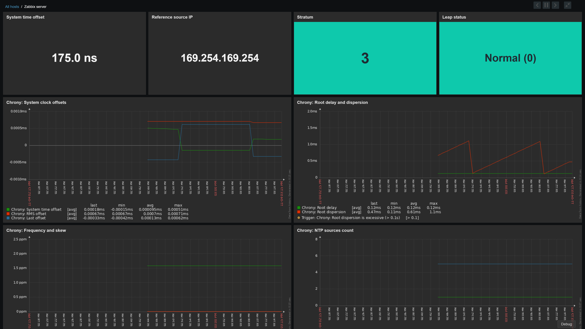
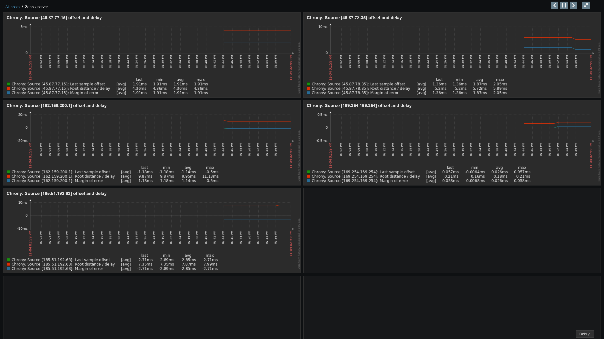
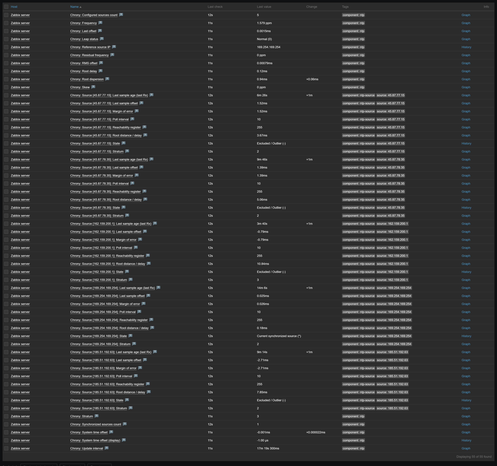

# Zabbix Chrony NTP Monitoring Template (`zabbix-template-chrony`)

[🇬🇧 Read in English](README.md) | [🇷🇺 Читать на русском](README_RU.md)

[](https://www.zabbix.com/)
[](https://chrony-project.org/)
[](https://www.zabbix.com/documentation/current/en/manual/concepts/agent2)
[](https://github.com/qwertykolea/zabbix-template-chrony)

Профессиональный production-ready комплекс для мониторинга клиента NTP (`chrony`) с помощью **Zabbix Agent 2**.

Разработано в соответствии с официальными стандартами Zabbix 7.4: архитектура **Master + Dependent Items**, парсинг сырых CSV данных через нативный Preprocessing, низкоуровневое обнаружение источников времени (LLD), встроенный нативный дашборд Zabbix 7.0+, готовый дашборд для Grafana, отсутствие внешних bash-скриптов и нулевая нагрузка на серверы.

---

## 🚀 Ключевые особенности проекта

* **Минимальная нагрузка на систему**: Всего 2 вызова `chronyc` в минуту (`tracking` и `sources`) в формате однострочного CSV. Никаких лишних fork-процессов и фоновой нагрузки на процессор.
* **Zero-Script архитектура**: Ни одного внешнего bash/awk/sed скрипта. Вся настройка агента заключается в единственном конфигурационном файле (`/etc/zabbix/zabbix_agent2.d/chrony.conf`).
* **Независимость от локали ОС**: Парсинг CSV выполняется нативно в оперативной памяти Zabbix средствами JavaScript и JSONPath. Корректно работает на любых дистрибутивах Linux независимо от системного языка.
* **Поддержка клиентских и серверных режимов**: Одинаково надежно мониторит как чистые NTP-клиенты (виртуальные машины, рабочие станции), так и выделенные серверы времени.
* **Два режима работы (Passive и Active)**: Полноценные скомпилированные шаблоны для классического пассивного опроса сервером и активного агента за NAT/фаерволом.
* **Автоматическое обнаружение пиров (LLD)**: Автоматически находит все настроенные серверы времени и отслеживает персональное смещение, задержку, погрешность, стратум и регистр доступности.
* **Продуманная матрица триггеров**: Многоуровневые пороги (Warning, Critical, Info) с учетом зависимостей от работы службы `chronyd`, анонса високосной секунды и изоляции ложных источников (false tickers).
* **Встроенный многостраничный дашборд Zabbix**: Современные KPI-карточки, адаптивная многострочная сетка графиков всех пиров и синхронизация временных интервалов.
* **Готовый дашборд для Grafana**: Профессиональный JSON-дашборд, оптимизированный под официальный плагин Zabbix.

---

## 📁 Структура проекта

```text
zabbix-template-chrony/
├── README.md                                 # Английская документация
├── README_RU.md                              # Русская документация
├── agent2_conf/
│   └── chrony.conf                           # Конфигурация UserParameter для агента
├── templates/
│   ├── template_chrony_agent2_passive.yaml   # Шаблон для пассивного агента (Zabbix agent)
│   ├── template_chrony_agent2_active.yaml    # Шаблон для активного агента (Zabbix agent active)
│   └── generate.py                           # Детерминированный генератор шаблонов
├── dashboards/
│   └── grafana/
│       ├── chrony-overview.json              # Дашборд Grafana под официальный плагин Zabbix
│       ├── README.md                         # Инструкция по импорту в Grafana (EN)
│       └── README_RU.md                      # Инструкция по импорту в Grafana (RU)
└── deploy/
    ├── install.sh                            # Скрипт автоматической установки на Linux
    ├── uninstall.sh                          # Скрипт чистого удаления
    └── ansible/                              # Автоматизация для парка серверов
        ├── playbook.yml                      # Ansible playbook
        ├── inventory.ini.example             # Пример инвентаря
        ├── README.md                         # Инструкция к Ansible (EN)
        └── README_RU.md                      # Инструкция к Ansible (RU)
```

---

## ⚡ Быстрый старт (Установка на Linux-хост)

### Вариант 1: Однострочная онлайн-установка с GitHub (Рекомендуется)

```bash
curl -fsSL https://raw.githubusercontent.com/qwertykolea/zabbix-template-chrony/main/deploy/install.sh | sudo bash
```

### Вариант 2: Локальный запуск из клонированного репозитория

```bash
git clone https://github.com/qwertykolea/zabbix-template-chrony.git
cd zabbix-template-chrony/deploy
sudo chmod +x install.sh
sudo ./install.sh
```

### Вариант 3: Ручная установка (1 минута)

1. Скопируйте файл конфигурации:
   ```bash
   sudo cp agent2_conf/chrony.conf /etc/zabbix/zabbix_agent2.d/chrony.conf
   sudo chmod 644 /etc/zabbix/zabbix_agent2.d/chrony.conf
   ```

2. Перезапустите службу агента:
   ```bash
   sudo systemctl restart zabbix-agent2
   ```

3. Проверьте опрос метрик:
   ```bash
   zabbix_agent2 -t chrony.tracking
   zabbix_agent2 -t chrony.sources
   ```

---

## 🖥️ Настройка в Zabbix Web UI

1. Перейдите в **Data collection** -> **Templates** -> кнопка **Import**.
2. Выберите подходящий файл из папки `templates/`:
   * `template_chrony_agent2_passive.yaml` — для серверов, доступных Zabbix-серверу/прокси напрямую по порту 10050.
   * `template_chrony_agent2_active.yaml` — для серверов за NAT / Firewall, где агент сам инициирует исходящее соединение на 10051 порт.
3. Привяжите импортированный шаблон к целевым хостам в разделе **Hosts**.
4. Проверьте поступление данных в **Monitoring** -> **Latest data** (фильтр `Chrony`).

---

## 📊 Состав метрик

### 1. Системные метрики синхронизации (System Tracking)

* **`Chrony: Service process state` (`proc.num[chronyd]`)**  
  * **Назначение**: Проверяет, запущен ли фоновый процесс демона `chronyd`.
  * **Значения**: `1` = Работает, `0` = Остановлен / Упал.
  * **Критический порог**: При `0` немедленно генерируется алерт важности **High**, который глушит каскадные ложные тревоги от остальных триггеров.

* **`Chrony: System time offset` (`chrony.tracking.offset.system`)**  
  * **Назначение**: Разница во времени между локальными системными часами ядра Linux и эталонным временем.
  * **Единицы измерения**: Секунды (`s`, float). Положительное (`+`) — часы спешат; отрицательное (`-`) — часы отстают.
  * **Шкала значений и состояние синхронизации**:
    * **Идеально ($\pm 0$ до $\pm 1$ мс / $< 0.001$ с)**: Высокоточная синхронизация уровня дата-центра (субмиллисекундная и микросекундная точность).
    * **Нормально (до $\pm 10$–$20$ мс)**: Стандартная норма для виртуальных машин и облачных серверов при синхронизации через публичный интернет.
    * **Предупреждение ($> 100$ мс / $> 0.1$ с на протяжении 3+ минут)**: Превышение макроса `{$CHRONY.OFFSET.WARN}`. Риск задержек репликации в базах данных (PostgreSQL, MySQL, ClickHouse) и рассинхрона кворума в распределенных кластерах (Kubernetes, etcd, Ceph).
    * **Критично ($> 500$ мс / $> 0.5$ с)**: Превышение макроса `{$CHRONY.OFFSET.CRIT}`. Приводит к сбоям авторизации (Kerberos, OAuth2/JWT), рассинхронизации кодов двухфакторной аутентификации TOTP и ошибкам проверки TLS-сертификатов.

* **`Chrony: System time offset (display)` (`chrony.tracking.offset.system.display`)**  
  * **Назначение**: Человекочитаемое строковое представление смещения с автоматическим выбором единиц (`ns`, `µs`, `ms`, `s`) для отображения в интерфейсе и отправки в каналы оповещений (Telegram, Slack, Email).

* **`Chrony: Stratum` (`chrony.tracking.stratum`)**  
  * **Назначение**: Уровень стратума — количество сетевых хопов/шагов от сервера до первичного физического эталона времени.
  * **Значения (от 0 до 16)**:
    * `Stratum 0`: Физические аппаратные часы (атомные цезиевые стандарты, рубидиевые генераторы, GPS/ГЛОНАСС-приемники с PPS-сигналом).
    * `Stratum 1`: Первичные серверы времени, напрямую аппаратно подключенные к Stratum 0.
    * `Stratum 2`: Вторичные серверы, синхронизирующиеся со Stratum 1 по сети (Cloudflare, Google, NTP Pool).
    * `Stratum 3`: Стандартные клиентские серверы (обычное здоровое состояние для 99% серверов в сети).
    * `Stratum 4–5`: Допустимо в изолированных корпоративных сетях или при работе через локальные NTP-шлюзы.
    * `Stratum >= 5` (Предупреждение): Срабатывает при деградации уровня стратума на 15+ минут, свидетельствуя о ненадежности цепочки серверов.
    * `Stratum 16` (или `0`) (**Критично**): Стандартный код протокола NTP, означающий **полную рассинхронизацию** (сервер потерял связь со всеми источниками).

* **`Chrony: Leap status` (`chrony.tracking.leap_status`)**  
  * **Назначение**: Статус секунд координации (Leap Second) и фиксации привязки к эталону UTC.
  * **Значения**:
    * `0 — Normal`: Нормальное состояние; привязка стабильна, коррекций не ожидается.
    * `1 — Insert second`: Вышестоящие серверы анонсировали вставку високосной секунды (`23:59:60`) в конце суток (срабатывает **Info**-алерт для подготовки СУБД).
    * `2 — Delete second`: Теоретическое удаление секунды (пропуск `23:59:59`).
    * `3 — Not synchronised` (**Критично**): Chrony потерял связь со всеми серверами времени; часы свободно дрейфуют на собственном генераторе.

* **`Chrony: RMS offset` (`chrony.tracking.offset.rms`)**  
  * **Назначение**: Долгосрочное среднеквадратичное отклонение времени. Показывает сглаженную среднюю точность хода часов без влияния единичных сетевых выбросов.

* **`Chrony: Last offset` (`chrony.tracking.offset.last`)**  
  * **Назначение**: Оценочное отклонение времени, зафиксированное при последнем единичном замере пакета NTP.

* **`Chrony: Root delay` (`chrony.tracking.root_delay`)**  
  * **Назначение**: Суммарная сетевая задержка передачи пакетов по всему маршруту до первичного эталона Stratum 1.

* **`Chrony: Root dispersion` (`chrony.tracking.root_dispersion`)**  
  * **Назначение**: Суммарная накопленная погрешность дисперсии до эталона времени.
  * **Порог предупреждения**: Значения $> 100$ мс на протяжении 5+ минут вызывают Warning, свидетельствуя о джиттере или деградации канала связи до NTP-серверов.

* **`Chrony: Frequency` (`chrony.tracking.freq_ppm`)**  
  * **Назначение**: Скорость опережения или отставания локального кварцевого генератора относительно эталона в миллионных долях (`ppm`, parts per million, $1\text{ ppm} \approx 0.086\text{ с/сутки}$).

* **`Chrony: Residual frequency` (`chrony.tracking.residual_freq`)**  
  * **Назначение**: Остаточная погрешность частоты между текущей скоростью часов и скорректированной скоростью (`ppm`). В стабильном состоянии стремится к нулю.

* **`Chrony: Skew` (`chrony.tracking.skew_ppm`)**  
  * **Назначение**: Доверительный интервал (погрешность оценки) частоты генератора в `ppm`. Чем ниже значение, тем стабильнее частота кварца.

* **`Chrony: Update interval` (`chrony.tracking.update_interval`)**  
  * **Назначение**: Интервал в секундах между двумя последними фактическими корректировками системного времени.

* **`Chrony: Reference source IP` (`chrony.tracking.ref_ip`)**  
  * **Назначение**: IP-адрес или идентификатор текущего активного сервера времени. Отслеживается на флаппинг (> 5 смен за 1 час генерируют Info-уведомление).

### 2. Сводные метрики источников (Sources Summary)
* `Chrony: Configured sources count` — общее число настроенных NTP-серверов в пуле.
* `Chrony: Synchronized sources count` — количество источников в статусе синхронизации (`*` или `+`).

### 3. Низкоуровневое обнаружение источников (LLD)
Zabbix автоматически обнаруживает каждый апстрим-источник времени и создает персональные элементы данных:
* `Chrony: Source [{#SOURCE_NAME}]: State` — статус источника (`*` = синхронизирован, `+` = кандидат, `-` = отсеян, `?` = недоступен, `x` = ложный источник / falseticker, `~` = высокая вариативность джиттера).
* `Chrony: Source [{#SOURCE_NAME}]: Stratum` — стратум конкретного сервера.
* `Chrony: Source [{#SOURCE_NAME}]: Reachability register` — 8-битный регистр доступности (преобразован из восьмеричной системы в диапазон 0–255: `255` = 100% ответов на последние 8 запросов, `0` = сервер недоступен).
* `Chrony: Source [{#SOURCE_NAME}]: Last sample offset` — персональное смещение относительно данного источника (`s`).
* `Chrony: Source [{#SOURCE_NAME}]: Root distance / delay` — сетевая задержка до данного источника (`s`).
* `Chrony: Source [{#SOURCE_NAME}]: Margin of error` — доверительный интервал погрешности измерения смещения (`s`).
* `Chrony: Source [{#SOURCE_NAME}]: Last sample age (last Rx)` — время в секундах с момента получения последнего пакета от источника (`s`).
* `Chrony: Source [{#SOURCE_NAME}]: Poll interval` — интервал опроса источника (log2).

---

## 🔔 Матрица триггеров и алертинга

| Важность (Severity) | Название триггера | Условие срабатывания | Описание и зависимости |
| :--- | :--- | :--- | :--- |
| **High** | `Chrony: Service process is not running` | `last(proc.num[chronyd])=0` | Служба `chronyd` остановлена или упала. |
| **High** | `Chrony: Host is not synchronised with NTP` | `last(chrony.tracking.leap_status)=3` | Потеряна связь со всеми серверами времени (зависит от работы службы). |
| **High** | `Chrony: Stratum is invalid (0 or >= 16)` | `stratum=0 or stratum>=16` | Источники не отдают валидный стратум (зависит от работы службы). |
| **High** | `Chrony: No synchronized NTP sources available` | `max(synced_count, 10m)=0` | Нет ни одного синхронизированного (`*`) или кандидатного (`+`) сервера времени на протяжении 10 минут. |
| **Warning** | `Chrony: Clock offset is excessive (> 100ms)` | `min(offset, 3m) > 0.1s or max(offset, 3m) < -0.1s` | Дрейф времени превышает 100 мс на протяжении более 3 минут (сглаживание сетевых пиков). |
| **High** | `Chrony: Clock offset is critical (> 500ms)` | `last(offset) > 0.5s or last(offset) < -0.5s` | Критическое расхождение времени. Зависит от предупреждающего триггера. |
| **Warning** | `Chrony: Root dispersion is excessive (> 100ms)` | `min(root_dispersion, 5m) > 0.1s` | Расчетная погрешность дисперсии превышает `{$CHRONY.DISPERSION.WARN}` на протяжении 5 минут. Ранний признак деградации сетевого маршрута. |
| **Warning** | `Chrony: NTP stratum increased (Stratum >= 5)` | `min(stratum, 15m)>=5 and last(stratum)<16` | Уровень стратума деградировал до 5 или выше на протяжении 15 минут. |
| **Info** | `Chrony: Leap second announcement detected` | `leap_status=1 or leap_status=2` | Вышестоящие NTP-серверы анонсировали вставку или удаление високосной секунды. |
| **Info** | `Chrony: Active reference source is flapping` | `changecount(ref_ip, 1h) > 5` | Активный сервер времени сменился более 5 раз за последний час. Признак нестабильности сетевого пути или джиттера. |
| **Warning (Отключен по умолчанию)** | `Chrony: Low number of synchronized NTP sources (< 2)` | `last(synced_count) < 2` | Число активных синхронизированных источников упало ниже порога. Можно включить в интерфейсе Zabbix. |
| **Warning (Прототип)** | `Chrony: NTP source [{#SOURCE_NAME}] is flagged as false ticker` | `last(state)="x"` | Chrony выявил, что данный сервер передает недостоверное время. |
| **Info (Прототип)** | `Chrony: NTP source [{#SOURCE_NAME}] is unreachable` | `last(reach)=0` | Все 8 последних попыток связаться с источником завершились неудачей. |
| **Info (Прототип)** | `Chrony: NTP source [{#SOURCE_NAME}] response is delayed (> 1h)` | `min(last_rx, 15m) > 3600` | От данного источника нет ответов более 1 часа. |

### Пользовательские макросы (User Macros):
Вы можете настраивать пороги прямо в шаблоне или на уровне конкретного хоста:
* `{$CHRONY.OFFSET.WARN}`: `0.1` (порог предупреждения в секундах, по умолчанию 100 мс);
* `{$CHRONY.OFFSET.CRIT}`: `0.5` (критический порог в секундах, по умолчанию 500 мс);
* `{$CHRONY.DISPERSION.WARN}`: `0.1` (порог предупреждения для корневой дисперсии в секундах, по умолчанию 100 мс);
* `{$CHRONY.SOURCES.MIN.WARN}`: `2` (минимальное число источников для опционального триггера).

---

## 📈 Визуализация и дашборды

### 1. Встроенный многостраничный дашборд шаблона (Zabbix 7.0 LTS / 7.4+)
В шаблон интегрирован современный нативный дашборд **Chrony NTP overview**, доступный сразу в дашбордах хоста:

* **Страница 1: Overview**
  
  * **Современные KPI-карточки**: Аккуратные карточки только со значением, выверенным размером шрифта и цветовыми порогами состояний:
    * `System time offset`: Адаптивное человекочитаемое отображение с автоматическим выбором единиц (`ns`, `µs`, `ms`, `s`) — избавляет от длинных цепочек нулей (например, `149.0 ns` вместо `0.000149ms`);
    * `Reference source IP`: Полный IPv4-адрес без сокращений и обрезания троеточием;
    * `Stratum`: Целочисленное отображение (`3` вместо `3.00`) с цветовой индикацией (`зеленый` 1–3, `желтый` 4–9, `красный` 16);
    * `Leap status`: Полный статус (`Normal`, `Insert second`, `Not synchronised`) без обрезания текста.
  * **График смещения времени**: Сравнение System time offset, RMS offset и Last offset.
  * **График сетевых задержек и дисперсии**: Root delay и Root dispersion до эталона Stratum 1.
  * **График частоты и стабильности кварца**: Дрейф частоты (ppm) и расчетная погрешность (skew).
  * **График количества источников (NTP sources count)**: Динамика настроенных и активных синхронизированных серверов во времени.
  * **Сетка графиков LLD-источников**: Полноширинная сетка 2 колонки на 3 строки со смещением, задержкой и погрешностью до 6 обнаруженных серверов.

* **Страница 2: NTP Sources (Peers)**
  
  * Выделенная вкладка с сеткой на 6 строк и 2 колонки (до 12 графиков одновременно без пагинации) и высотой 24 единицы, где одновременно отображаются графики всех обнаруженных серверов времени. Каждый график отображает сразу 3 ключевых параметра: **Offset** (зеленый), **Delay** (красный) и **Margin of error** (синий).

### 2. Раздел «Последние данные» (Latest data в Zabbix Web UI)

Все собираемые метрики структурированы и снабжены тегами компонентов: `component: ntp` (системный статус демона и метрики tracking) и `component: ntp-source` (индивидуальные метрики каждого обнаруженного пира с тегом `source: <ip>`). Это обеспечивает мгновенную фильтрацию и просмотр истории в интерфейсе **Мониторинг → Последние данные**.

### 3. Готовый дашборд для Grafana
Для тех, кто использует Grafana с официальным **плагином Zabbix** (`alexanderzobnin-zabbix-datasource`), в папке [`dashboards/grafana/`](dashboards/grafana/) подготовлен файл экспорта:
* Выпадающие списки выбора группы узлов и конкретного узла сети.
* Подробные графики и карточки ключевых метрик.
* Инструкция по импорту находится в [руководстве по Grafana](dashboards/grafana/README_RU.md).

---

## 🛠️ Диагностика и проверка с хоста

Если при проверке командой `zabbix_agent2 -t chrony.tracking` возвращается ошибка или пустое значение:

1. **Проверьте права пользователя `zabbix`**:
   ```bash
   sudo -u zabbix chronyc -c tracking
   ```
2. **Если сокет `/run/chrony/chronyd.sock` закрыт**:
   Убедитесь, что каталог `/run/chrony` имеет права на чтение:
   ```bash
   chmod o+rx /run/chrony
   chmod 666 /run/chrony/chronyd.sock
   ```
3. **Проверьте синтаксис UserParameter через агент**:
   ```bash
   zabbix_agent2 -t chrony.sources
   ```

---

## 🗑️ Удаление

Для полного удаления конфигурации с хоста:

```bash
curl -fsSL https://raw.githubusercontent.com/qwertykolea/zabbix-template-chrony/main/deploy/uninstall.sh | sudo bash
```
